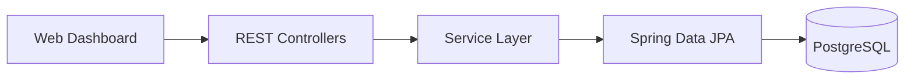

# Transact

Transact is a concurrent virtual payment transaction processing system built with Java, Spring Boot, and PostgreSQL. It demonstrates reliable fund transfers, database transaction boundaries, concurrency-safe balance updates, idempotent request handling, and a lightweight web dashboard.

> Transact uses demo accounts and virtual funds. It does not process real payments or connect to banks or payment networks.

## Overview

The project focuses on the correctness problems behind moving money-like values between accounts. A transfer must debit one account, credit another, and save its history record as one atomic operation. Concurrent requests must not lose updates or create negative balances, and a retried request must not move funds twice.

Transact provides a browser dashboard for demonstrations and a REST API for direct testing. PostgreSQL is the source of truth for balances and transfer history.

## Features

- Create and inspect demo accounts with decimal balances.
- Transfer virtual funds atomically between distinct accounts.
- Reject invalid amounts, missing accounts, and insufficient balances.
- Lock account rows in deterministic order for concurrent transfers.
- Replay identical idempotent requests without moving funds again.
- Reject reuse of an idempotency key with a different payload.
- Browse the 100 most recent completed transfers.
- Search transfers with combinable filters and bounded pagination.
- Read an account statement with incoming and outgoing transfers.
- Inspect aggregate account and transfer totals and UTC daily transfer volume.
- Use a responsive HTML, CSS, and vanilla JavaScript dashboard.
- Retry uncertain dashboard submissions with the original request and key.
- Return concise JSON validation and error responses.

## Technology Stack

- Java 21 target; locally verified with JDK 23
- Spring Boot 4.0.9
- Spring Web MVC, Spring Data JPA, and Bean Validation
- PostgreSQL 18 and the PostgreSQL JDBC driver
- Maven Wrapper
- JUnit 5 and Mockito
- HTML, CSS, and vanilla JavaScript

Money is represented with `BigDecimal` in Java and `NUMERIC(19,2)` in PostgreSQL.

## Architecture



- **Web Dashboard:** calls the same-origin account and transfer APIs and renders API data safely with DOM APIs.
- **REST Controllers:** validate request DTOs and map results to HTTP responses.
- **Service Layer:** owns transaction boundaries, transfer rules, idempotency, and balance changes.
- **Spring Data JPA:** persists entities and obtains pessimistic database locks.
- **PostgreSQL:** stores accounts and completed transfers and enforces idempotency-key uniqueness.

## Transaction Processing

`POST /api/transfers` validates the account IDs, positive decimal amount, and `Idempotency-Key`. The service then obtains a PostgreSQL transaction-scoped advisory lock derived from the key. Requests using the same key are serialized before the existing-transfer lookup.

An identical completed request returns the original transfer. A different payload with the same key returns `409 Conflict`. A database unique constraint provides a second enforcement layer.

For a new transfer, both account rows are locked with pessimistic write locks. Locks are always acquired in ascending account-ID order to reduce deadlock risk. The sender balance is checked only after locking. Debit, credit, and transfer-history insertion run inside one `@Transactional` method, so an exception rolls back the entire operation. Failed transactions do not consume the idempotency key.

This strategy has been exercised with focused PostgreSQL concurrency tests; it is not a formal verification of every possible concurrency scenario.

## API Endpoints

| Method | Endpoint | Purpose |
| --- | --- | --- |
| `POST` | `/api/accounts` | Create a demo account |
| `GET` | `/api/accounts` | List accounts and balances |
| `GET` | `/api/accounts/{id}` | Get one account |
| `GET` | `/api/accounts/{id}/statement` | Get an account's paged transfer statement |
| `POST` | `/api/transfers` | Transfer virtual funds |
| `GET` | `/api/transfers` | List recent transfers or search with filters |
| `GET` | `/api/transfers/{id}` | Get one transfer |
| `GET` | `/api/analytics/summary` | Get persisted account and completed-transfer totals |
| `GET` | `/api/analytics/daily-volume` | Get completed transfer volume by UTC day |

Create an account:

```http
POST /api/accounts
Content-Type: application/json

{"displayName":"Demo Wallet","initialBalance":500.00}
```

Create a transfer:

```http
POST /api/transfers
Content-Type: application/json
Idempotency-Key: demo-transfer-001

{"fromAccountId":1,"toAccountId":2,"amount":125.00}
```

A new transfer returns `201 Created`. An identical replay returns the original transfer with `200 OK`. Invalid requests return `400`, missing resources return `404`, and insufficient funds or a conflicting key return `409`.

### Transfer search and details

The dashboard still calls bare `GET /api/transfers`, which returns an array of the 100 most recent completed transfers. Supplying any search or pagination parameter, or `paged=true`, returns an object with `content`, `page`, `size`, `totalElements`, and `totalPages`. Results sort by `createdAt` descending, then `id` descending.

| Parameter | Meaning |
| --- | --- |
| `transactionId` | Exact transfer ID |
| `fromAccountId` | Sender account ID |
| `toAccountId` | Receiver account ID |
| `startDate` | Earliest UTC creation date, inclusive, `YYYY-MM-DD` |
| `endDate` | Latest UTC creation date, inclusive, `YYYY-MM-DD` |
| `page` | Zero-based page number; default `0` |
| `size` | Page size `1`-`100`; default `20` |

Filters can be combined. For example:

```http
GET /api/transfers?fromAccountId=1&startDate=2026-10-01&endDate=2026-10-31&page=0&size=20
```

`GET /api/transfers/{id}` continues to return the transfer ID, account IDs, amount, status, and creation timestamp, or `404` if the transfer does not exist. Invalid search IDs, dates, ranges, and page settings return `400`.

### Account statements and analytics

`GET /api/accounts/{id}/statement?page=0&size=20` returns `accountId`, `displayName`, `currentBalance`, and paged `entries`. Each entry contains `transferId`, `createdAt`, `direction` (`DEBIT` or `CREDIT`), `counterpartyAccountId`, `amount`, and `status`. Entries use the same newest-first ordering as transfer search. Unknown accounts return `404`.

`GET /api/analytics/summary` returns `accountCount`, `completedTransferCount`, `totalTransferredAmount`, and `totalAccountBalances`. The transfer amount sums each completed transfer once; account balances are summed separately.

`GET /api/analytics/daily-volume` defaults to the last seven UTC calendar days, including today. Optional `startDate` and `endDate` parameters select an inclusive range of at most 366 days. It returns chronologically ordered entries with `date`, `completedTransferCount`, and `totalAmount`. Days without completed transfers appear with zero values. Aggregation runs in PostgreSQL; the service fills zero-volume dates afterward.

## Getting Started

### Prerequisites

- Java 21 or a newer JDK capable of targeting Java 21
- PostgreSQL
- Git

Maven does not need to be installed globally because the repository includes the Maven Wrapper.

### Database and configuration

Create a local PostgreSQL database named `transact`:

```sql
CREATE DATABASE transact;
```

Supply credentials through environment variables:

```powershell
$env:DB_URL = 'jdbc:postgresql://localhost:5432/transact'
$env:DB_USERNAME = 'postgres'
$env:DB_PASSWORD = '<your local password>'
```

The URL and username have local defaults; the password does not. As an alternative, create the Git-ignored `application-local.properties` in the repository root:

```properties
spring.datasource.username=postgres
spring.datasource.password=<your local password>
```

No Spring profile activation is required. When using this file, explicitly add it as a configuration location when starting the application. Credentials and local configuration must remain outside Git.

For local development, Hibernate updates the schema through `spring.jpa.hibernate.ddl-auto=update`. A production system should use versioned database migrations instead.

### Build and run

On Windows PowerShell:

```powershell
.\mvnw.cmd clean package
java -jar target/transact-0.0.1-SNAPSHOT.jar --spring.config.additional-location=optional:file:./application-local.properties
```

With environment variables, run `./mvnw spring-boot:run` on macOS/Linux or `.\mvnw.cmd spring-boot:run` on Windows.

Spring Boot uses port 8080 by default. Port 18080 was used during local verification because 8080 was occupied:

```powershell
java -jar target/transact-0.0.1-SNAPSHOT.jar --spring.config.additional-location=optional:file:./application-local.properties --server.port=18080
```

Open `http://localhost:8080/`, or `http://localhost:18080/` when using the alternate port.

## Testing

Run the fast unit tests:

```powershell
.\mvnw.cmd test
```

`AccountServiceTests` checks account creation, missing-account behavior, and request validation without a database.

Run the real PostgreSQL integration and concurrency tests with the ignored local configuration file:

```powershell
.\mvnw.cmd '-Dtransact.integration=true' '-Dspring.config.additional-location=optional:file:./application-local.properties' test
```

`TransferIntegrationTests` verifies successful balance updates, rollback after insufficient funds, same-account rejection, history, idempotent replay and conflict behavior, failed-key reuse, concurrent shared-account transfers, and concurrent same-key requests. Request DTO constraints cover positive amounts and valid account IDs at the REST boundary.

`ReadApiIntegrationTests` exercises database filtering, pagination, account statement directions, persisted analytics totals, UTC daily volume, and invalid ranges against PostgreSQL. The browser dashboard still uses the original transfer-list response; the new read APIs are backend-only in this milestone.

## Screenshots

The dashboard is available at the application root after startup. A repository screenshot has not been added; capture the dashboard with representative demo data and add it under `docs/` if a static preview is desired later.

## Demo

See [DEMO.md](DEMO.md) for a focused 3-5 minute interview walkthrough.

## Project Scope

Transact is an educational virtual payment simulator. It has no authentication, real banking integration, card processing, external payment network, PCI DSS claim, or production security claim. The current schema-update strategy and local credential setup are intended for development and portfolio demonstration.
